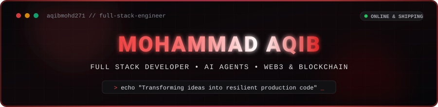
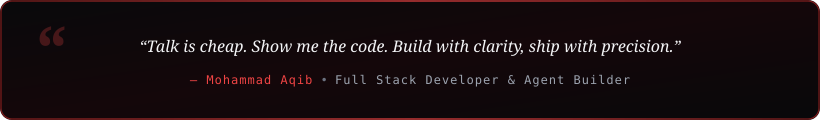

  

  

  
  
  
  
  
  

  

<h2 align="center"> About Me</h2>

  

  

  Hey! I'm <b>Mohammad Aqib</b>, a passionate <b>Full Stack Developer</b> interested in building useful web applications, autonomous AI agent tools, and connecting platforms with robust APIs and blockchain technologies. 
  My featured work focuses on developing tailored AI assistants, durable task execution pipelines, smart contract integrations, and modern full-stack web architectures.

  
  
  

  <b>Let's Discuss:</b> TypeScript, Python, Next.js, Go, Solidity, JavaScript, PHP, AI Agents & System Architecture. 
  <b>Philosophy:</b> <i>"I love turning complex ideas into resilient, production-ready software!"</i>

<table width="100%" border="0" align="center">
  <tr>
    <td width="50%" align="center" style="padding: 14px;">
      <h4> Flagship Project</h4>
      
<a href="https://github.com/aqibmohd271/Codex-open-dot" target="_blank"><b>Codex-open-dot</b></a> Personal AI Agents for macOS

    </td>
    <td width="50%" align="center" style="padding: 14px;">
      <h4> Active Deep Dives</h4>
      
<b>AI Agents & Go</b> Durable Workflows & Blockchain

    </td>
  </tr>
  <tr>
    <td width="50%" align="center" style="padding: 14px;">
      <h4> Technical Focus</h4>
      
<b>Full-Stack & APIs</b> AI Integrations & Verification

    </td>
    <td width="50%" align="center" style="padding: 14px;">
      <h4> Collaboration</h4>
      
<b>AI, Web3 & Open Source</b> Open to exciting new projects

    </td>
  </tr>
</table>

<h2 align="center"> Featured Project Spotlight</h2>
<table width="100%" border="0" align="center">
  <tr>
    <td align="center" style="padding: 22px;">
      <h3> 🤖 Codex-open-dot</h3>
      
<i>A customized personal AI agent app for macOS based on Composio Community's Open Dot. My edition brings together custom model providers, durable tasks, approval controls, searchable knowledge, and reusable workflows.</i>

       
      

        
        
        
        
        
        
        
        
      

       
      <markdown-accessiblity-table>
        <table align="center" border="1" style="border-collapse: collapse; margin: 12px auto;">
          <thead>
            <tr>
              <th align="left">Project</th>
              <th align="left">What it does</th>
              <th align="left">My contribution</th>
            </tr>
          </thead>
          <tbody>
            <tr>
              <td align="left"><a href="https://github.com/aqibmohd271/Codex-open-dot"><strong>🤖 Codex-open-dot</strong></a></td>
              <td align="left">Personal AI agents for macOS with configurable providers, tasks and workflows.</td>
              <td align="left">Customized edition, additional features, branding and documentation. Based on Open Dot; upstream authors remain credited.</td>
            </tr>
            <tr>
              <td align="left"><a href="https://github.com/aqibmohd271/whatsender-mcp"><strong>💬 Whatsender-MCP</strong></a></td>
              <td align="left">Self-hosted WhatsApp gateway with eight MCP tools, a REST API, messaging automation and a web dashboard.</td>
              <td align="left">Customized edition, branding, setup improvements and documentation. Based on WA-AKG; upstream authors remain credited.</td>
            </tr>
          </tbody>
        </table>
      </markdown-accessiblity-table>
       
      

        
        
        
        
      

    </td>
  </tr>
</table>

### What I'm focusing on

- Making AI agents easier to configure and use.
- Connecting applications with model APIs and custom tools.
- Improving task recovery, action approvals and verification.
- Building clear interfaces and practical documentation.

<h2 align="center"> LeetCode Problem Solving</h2>

<i>Live real-time tracker of coding challenges & algorithmic problem-solving milestones.</i>

  

  
  

<h2 align="center"> Tech Stack & Skills</h2>

<b>Core Programming Languages</b>

  

<b>Frontend & UI Development</b>

  

<b>Backend, Systems & Databases</b>

  

<b>AI, Blockchain, DevOps & Tools</b>

  

  
  
  
  
  
  
  
  

<h2 align="center"> GitHub Analytics & Activity</h2>

  
  

  

  

<h2 align="center"> Contribution Journey</h2>

  

<h2 align="center"> Let's Connect & Collaborate</h2>

<i>Whether you want to discuss system architecture, AI agent development, or explore open-source collaboration — my inbox is always open!</i>

<table border="0" align="center">
  <tr>
    <td align="center" width="220" style="padding: 16px;">
      <a href="https://github.com/aqibmohd271" target="_blank">
        
          
        
      </a>
       
      <b>Developer Profile</b>
    </td>
    <td align="center" width="220" style="padding: 16px;">
      <a href="mailto:aqibmohd27@gmail.com">
        
          
        
      </a>
       
      <b>Direct Collaboration</b>
    </td>
    <td align="center" width="220" style="padding: 16px;">
      <a href="https://linkedin.com/in/aqibmohd271" target="_blank">
        
          
        
      </a>
       
      <b>Professional Network</b>
    </td>
  </tr>
</table>

<h3 align="center">Find me on GitHub</h3>

  Browse <a href="https://github.com/aqibmohd271?tab=repositories">my repositories</a>, explore <a href="https://github.com/aqibmohd271/Codex-open-dot">Codex-open-dot</a>, or start a project-related conversation in its <a href="https://github.com/aqibmohd271/Codex-open-dot/issues">issues</a>.

  

Thanks for visiting — take a look around 👨‍💻

